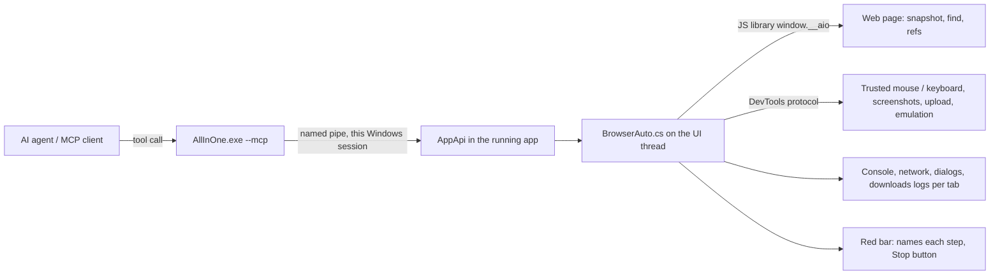

# Browser automation (app browser)

The app's Browser page (Edge WebView2) is a full automation browser for AI agents. Agents reach it through the app's
tools (MCP `AllInOne.exe --mcp`, the Assistant, Agents), which run inside the running app over its local named pipe.

## How it works

- **Refs**: `browser_snapshot` marks every visible clickable / typeable element (`data-aio-ref="e12"`), including
  same-origin iframes and open shadow DOM. Other tools take `ref`, a CSS `selector`, or visible `text` / `label`.
- **Real input**: clicks, hover, scroll and keys go through `Input.dispatchMouseEvent` / `dispatchKeyEvent` /
  `insertText`, so pages see trusted events (`isTrusted = true`), like a person using the mouse and keyboard.
- **Waiting**: clicks and keys wait for a page change they cause and report a new tab or dialog; `browser_wait`
  waits for an element, text, address, page load or network idle.

## Tools

| Tool | Does |
|---|---|
| `browser_snapshot` | Elements with refs, role, name, value, state; title, address, headings, open modal, optional text |
| `browser_navigate` | go / back / forward / reload / stop; waits for load; HTTP status and load errors |
| `browser_click` | Left / right / middle / double click by ref, selector, text or x,y; refuses disabled; warns if covered |
| `browser_hover` | Mouse over an element (hover menus, tooltips) |
| `browser_fill` | Type into a field (replace or append); `fields` fills a whole form; `submit` presses Enter |
| `browser_select` | Choose option(s) in a `<select>` by text or value |
| `browser_key` | Keys and combinations (`Enter`, `Control+A`, `Tab Tab Enter`), `type_text` |
| `browser_scroll` | Element into view, top / bottom, or mouse wheel by pixels |
| `browser_wait` | Element / text / address / load / network idle, or gone; or plain ms |
| `browser_tabs` | list, new, switch, close |
| `browser_screenshot` | Visible part, full page, or one element, PNG |
| `browser_pdf` | Page as PDF |
| `browser_upload` | Files into `input[type=file]` without the file dialog |
| `browser_downloads` | List, or wait for a download to finish |
| `browser_dialogs` | alert / confirm / prompt: the user answers (default), or accept / dismiss automatically |
| `browser_console` | Console messages and JavaScript errors |
| `browser_network` | Requests with status, type, size, errors (`failed_only`) |
| `browser_cookies` | list / set / delete / clear |
| `browser_emulate` | Phone, android, tablet, custom size, user agent, offline; `desktop` resets |
| `browser_extract` | text, links, tables (rows), forms (fields, options), images, headings, meta |
| Older: `browser_open`, `browser_read`, `browser_run_js`, `browser_cdp` | Still available |

## The user stays in control

- A red bar above the page names every agent step; the element acted on is outlined for a moment.
- **Stop agent** on the bar (or Browser > More > *Let AI agents use this browser*) blocks all agent browser tools
  until the user allows them again. Waits in progress stop too.
- Browser > More > *What agents did in this browser...* lists the steps.
- Page dialogs go to the user unless an agent explicitly sets `accept` / `dismiss`.
- The browser works on the user's own signed-in profile (`data\browser\profile`).

## Test

`tools\test-browser-automation.ps1` (needs the running app with the current build and Python for a local web server):
44 checks on `tools\browser-test-site` in its own tabs, closed at the end.

## Limits

- Cross-origin iframes (for example embedded payment or sign-in frames from another site) are not in the snapshot;
  click them by `x`,`y` or open the frame address in its own tab.
- Closed shadow DOM is not reachable.
- While a page dialog waits for the user (mode `user`), other tools wait too; they time out with a clear message.
- The external DevTools port (More > Allow automation tools, port 9333) is separate and off by default.
