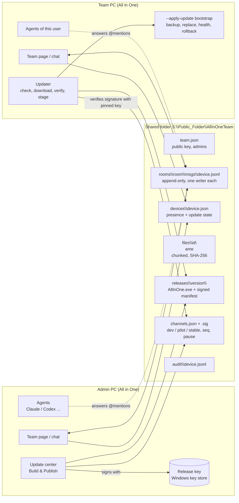
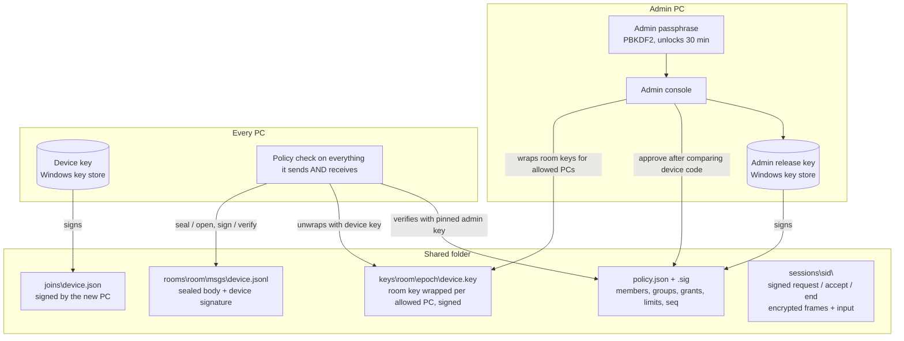

# Team: chat, files, agents and one-click updates

All in One users work together through **one shared network folder** (for example `S:\Public_Folder\AllInOneTeam`).
There is no server and no open port, so it works behind the corporate firewall. Everything is inside the single
`AllInOne.exe` (page **Team** in the sidebar).

## Architecture map

**Why it cannot corrupt shared data:** every PC writes only its own files (`msgs\<device>.jsonl`, `devices\<device>.json`,
`reads\<device>.json`, `audit\<device>.jsonl`). Shared admin files (`channels.json`, releases) are written only by the admin
PC, under `publish.lock`, signed, and replaced atomically. A release folder appears complete or not at all.

## Chat

| Feature | How it works |
|---|---|
| Rooms | General, Updates & Releases, group rooms, project rooms (tied to a project folder), private conversations (double-click a person) |
| Delivery | Each message has a unique id, time and sequence. Read incrementally (only new bytes). Duplicates (retried writes) are ignored. |
| Offline | Messages written while the folder is unreachable wait in a local outbox (on disk) and are sent when it is back, also after a restart. |
| Presence / typing | `devices\<device>.json` every 15 s (typing at once). Online = seen in the last 60 s. |
| Read receipts | `rooms\<room>\reads\<device>.json`; "Seen by ..." under the conversation. |
| Reactions, replies, edits, deletes, pins | Event messages; only the author can edit or delete. Right-click a message. |
| Mentions / notifications | `@name`, `@everyone`, private messages and release news show a Windows notification. |
| Search | Box at the top: searches all rooms. |
| Files | Button **Files** or drag and drop. Copied in 4 MB chunks, resumes after an interruption or restart, SHA-256 checked on upload and download. Saved to `Downloads\All in One Team`. |
| Problems | **Report problem** in Updates & Releases. Right-click > **Turn into a task** creates a task; closed tasks appear as "Fixed" in the next release notes. |

### Agents in rooms
- **My agents** (room header): tick the agents you share. Others call them with `@handle` (for example `@mohamed-claude`).
- The agent runs **on its owner's PC** with the owner's account and limits, in the room's project folder.
- Per room the owner chooses: **Not answer** / **Answer only (read-only, default)** / **Answer and change files**.
- The agent sees the last 25 room messages. Agents may mention other agents; at most 6 agent answers in a row (loop guard).

## Updates

### Channels
- **dev** - the admin's PC only (the developer build in the source folder is never overwritten).
- **pilot** - chosen PCs (Update center > select PCs > **Pilot PCs...**).
- **stable** - everyone, with a rollout percent. Reached **only by promoting** a pilot release. Promotion is refused while any pilot PC reports a failed install of that version.
- **Pause** stops all deployment (except releases marked **critical**).

### What a client does (every 2 minutes)
1. Reads `channels.json` and checks its signature with the key pinned at join time, and that its sequence number never goes back (replay protection).
2. Picks its channel's version, checks rollout and pause, reads the signed manifest.
3. Downloads the exe in chunks (resumes after interruption), checks the SHA-256 from the signed manifest, stages it in `%LocalAppData%\AllInOne\updates\<version>`.
4. Installs when the PC has been idle for 10 minutes and no agent is working, at once for a critical release, or when the user clicks **Restart and update now**.
5. Install: settings are saved and copied to `updates\backup-<time>`; the new exe starts as the updater (`--apply-update`), waits for the app to exit, keeps the old exe in `updates\previous`, replaces the exe, starts it and waits up to 90 s for its health signal (written 20 s after a good start). **No signal = the old exe is put back and started.** A failed version is not retried until the admin publishes again.
6. The result is reported in `devices\<device>.json` and shown in the Update center.

## Operating instructions

### Admin, first time
1. Open **Team**. Team folder: `S:\Public_Folder\AllInOneTeam` (any folder everyone can read and write). Type your name.
2. Click **Test folder**, then **Create team (I am the admin)**. This PC gets the release key (kept in the Windows key store of your account, never in the share).
3. Give users the exe once (or the team folder path). They open **Team** > **Join team**.

### Admin, every release: Build -> Test -> Publish -> Monitor
1. Team > **Update center** > **Build & Publish...**
2. Check the source folder, choose **pilot** (or dev), edit "What's new" (prefilled from git commits and closed problem tasks), tick **critical** only for urgent fixes.
3. **Build, test and publish**: compile check -> team tests (-> full suite if ticked) -> release build -> self-test of the built exe -> signed publish. Any failure stops before anything is published.
4. Watch **Computers**: pilot PCs go downloading -> staged -> installing -> up to date.
5. When the pilot is fine: **Promote pilot to stable...** (choose the percent, 100 = everyone). If something is wrong: **Pause** or **Rollback pilot / stable**.

Chat commands (in Updates & Releases, or anywhere starting with `/`): `/status`, `/devices` ("show computers still using the old version"),
`/failed`, `/pilot latest`, `/promote 50%`, `/pause`, `/resume`, `/rollback pilot|stable`, `/help`. Changes always ask for confirmation.

### Users
Open All in One -> updates arrive by themselves -> keep working. Problems: **Report problem** in Updates & Releases.

## Deployment checklist
- [ ] Choose the team folder; everyone can read and write it (`Test folder` on 2 PCs).
- [ ] Admin: Create team; back up nothing else - the release key lives in the admin's Windows account (moving the admin to another PC = create a new team key; members join again).
- [ ] Distribute `AllInOne.exe` once (installed or portable). A file `portable.txt` next to the exe keeps a copy portable (no install prompt).
- [ ] Each user: Team > Join team. Check they appear online in People and in the Update center.
- [ ] Pick 1-2 pilot PCs (Update center > select > Pilot PCs...).
- [ ] First release: Build & Publish to pilot; confirm pilot PCs reach "up to date"; promote to stable (try 25% first).
- [ ] Try one rollback on the pilot channel so everyone knows it works.

## Tests
- `tools\test-team.ps1` - 50 checks on temporary folders only: two/three simulated clients, 60 simultaneous messages, offline outbox and restart, duplicates, order, reactions/edits/pins/reads/search, private rooms, 9 MB interrupted+resumed upload, damaged file refused, publish, unauthorized publish, tampered manifest, tampered channels, replayed channels, pause, interrupted download resume, corrupted release refused, 3 simultaneous download processes, failed-pilot promotion guard, promote, rollback, install with health check, automatic rollback, user data kept, unreachable folder, admin chat commands and confirmation. Part of `tools\test-all.ps1`.
- `tools\test-team-e2e.ps1` - the real exe on a local test folder: the Build & Publish pipeline, then a real app copy that receives a forced pilot release, installs it through the updater, restarts and reports. Closes and restarts your normal app.

## Admin & user security (v2)

There is no server: anyone with access to the shared folder can read its files. So security is **cryptographic, and every
app enforces the same admin-signed policy** - not hidden buttons.

| Requirement | How it is enforced |
|---|---|
| Admin authentication | Admin actions need the admin PC's release key (Windows key store, user-bound) **and** the admin passphrase (PBKDF2-SHA1 200k, salted, only a hash on the admin PC, nothing hardcoded). Unlocks for 30 min; failed attempts are audited. |
| Device identity | Each PC creates an RSA-3072 key in its Windows key store. Joining writes a signed request; the admin compares the **device code** shown on both PCs and approves. Everything a PC writes is signed with its key. |
| Default deny | `policy.json` lists members (pending / approved / suspended / revoked / blocked, role, groups) and grants (who -> feature -> target). Nothing else is allowed. Admin role may do everything. Features: room, dm, files, agents, project, see, screen.view, screen.control (includes viewing), updates. Targets: everyone, a PC, a group, a room, a project folder (and its subfolders). |
| Central enforcement | The policy is signed by the admin key, sequence-numbered (a replayed old copy is rejected) and checked by every PC: a receiver drops messages from senders that are unknown, badly signed, or not allowed in that room / not allowed files or agents. Only allowed PCs get the room keys, so others cannot even read. |
| Encryption | Messages, files and remote sessions: AES-256-CBC + HMAC-SHA256 (encrypt-then-MAC). Room keys are wrapped per PC with RSA-OAEP. No message or file text is readable in the shared folder (tested). |
| Immediate revocation | Policy changes are picked up within ~2-4 s. Revoke / suspend / block clear the PC's keys; the admin PC **rotates the room keys** so a removed PC cannot read anything new; running remote sessions stop at the next frame. |
| Disconnect / terminate | **Close app now** closes All in One on that PC (work saved). **Block + close app** also keeps it out until the admin restores it. The admin cannot lock out their own PC. |
| Tampering and recovery | A tampered or replayed policy is rejected by everyone; the admin's next change rebuilds it from the last verified copy (audited "policy-repair"). |
| Audit | Every PC appends to `audit\<device>.jsonl`: unlocks (and failures), policy changes, approvals, denials, key rotations, terminations, file sends, every remote-assistance step. The admin console shows and filters them. |

### Remote assistance
- **Users:** **Get remote help** lists only the people the admin allowed to help them; one click shares the screen (that click is the approval). Right-click a person to share with them.
- **Helpers:** right-click a person > **Ask to view / control their screen**. The other PC shows a dialog: **Allow viewing only / Allow control / Deny** (no answer in 90 s = deny). Nothing is sent before the approval.
- **While it runs:** a red frame around all screens and a banner with the helper's name, *viewing* or *CONTROLLING*, the time left and a **Stop** button. Ends automatically at the policy time limit (default 30 min), by Stop on either side, by the admin, or when the permission is removed.
- **Security:** the session key is created by the shared PC and wrapped for the helper's device key only; frames (JPEG) and input are encrypted; input is applied only in control mode, only from the helper's key, never replayed. UAC prompts and the Windows sign-in screen are protected by Windows: they are not captured and cannot be controlled.
- **Speed:** through the shared folder, about 3-6 frames per second with ~0.3-1 s delay - fine for help and guidance, not for video.

### Admin console (Team > Admin console, passphrase)
People & PCs (approve with device code, suspend, restore, revoke, close app, block + close, groups) · Permissions (add / remove grants) · Rooms (who can read each room, key epoch) · Remote sessions (active ones in red, end any) · Audit log (filter) · Settings (session time limit, change passphrase, lock admin mode). The Update center (versions, pilot PCs, Build & Publish, rollback) stays on the Team page.

### Admin checklist (security)
- [ ] Choose a strong admin passphrase (8+ characters; longer is better). Only the admin PC knows it.
- [ ] Approve each PC only after comparing its device code (phone or in person).
- [ ] Put people in groups (for example `helpers`, `engineering`) and grant by group.
- [ ] Grant `screen.control` only to the IT helpers group; keep `screen.view` narrow too.
- [ ] Review the audit log and the Remote sessions tab regularly.

## Tests
- `tools\test-team.ps1` - 50 checks (chat, files, releases, updater) on the secured version.
- `tools\test-team-security.ps1` - 61 checks: passphrase rules, wrong passphrase, locked admin, approval with device code, forged join, pending PC (no rooms, no key, cannot send), encryption at rest for messages and files, forged sender, default deny, group room access and keys, non-member cannot write, project subfolder grants, tampered policy, replayed policy and admin repair, suspend / restore, revoke + key rotation, revoked PC cannot read or write, terminate, block, admin self-lockout guard, remote: no permission, nothing before approval, only the owner approves, downgrade to view, encrypted frames, view-only ignores input, forged input, control applies input, replayed input, permission removed mid-session, timeout, forged stop, admin stop, one-click help, share refused by policy, real Windows screen capture, audit entries.
- `tools\test-team-e2e.ps1` - real exe: Build & Publish (now also running the security suite), then an approved real app copy updates itself and reports.

## Not done / needs real-device validation
- Real network share (`S:\Public_Folder`): speed, permissions, antivirus scans - only local folders were tested. Nothing was written to `S:`.
- Two physical PCs at once (remote assistance between two real sessions; real mouse/keyboard injection was not run, to avoid moving your mouse - the input path is tested with a recorder, the capture path with the real screen).
- Remote assistance speed over the share is limited (no direct PC-to-PC streaming; the firewall rule was respected).
- What is NOT protected: anyone with write access to the share can delete or fill files (denial of service) - Windows folder permissions should limit write access to team members. A PC can still read history it was given before it was revoked. The People list visibility (`see`) is enforced by the app, not by encryption (presence files are signed, not encrypted). Read receipts and room names are not encrypted.
- One admin PC holds the admin key; moving the admin means creating a new team key (members rejoin).
- Secondary update server, voice messages: not built. Company code-signing certificate: not used (none found); releases use the team's own RSA-3072 signature.
